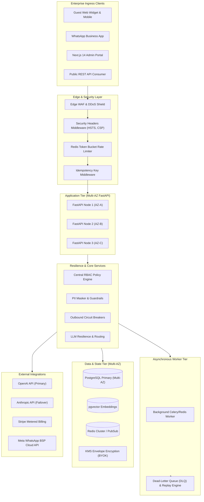
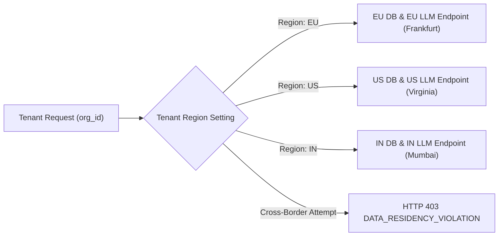
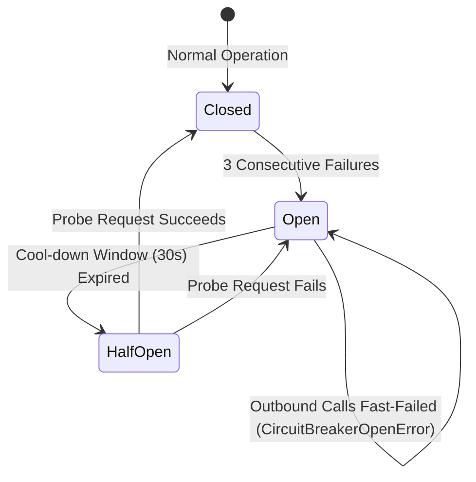

# Enterprise System Architecture

## 1. High-Level System Topology

---

## 2. Data Residency Boundary Routing

---

## 3. Resilience & Circuit Breaker State Machine

---

## 4. Multi-AZ High Availability Strategy
- **Database (PostgreSQL 16 + pgvector)**: Active-passive multi-AZ setup with synchronous streaming replication to AZ-B and asynchronous cross-region copy for DR.
- **In-Memory Cache (Redis 7)**: Multi-node cluster with automated sentinel failover and append-only file (AOF) persistence.
- **Stateless Compute (FastAPI & Next.js)**: Horizontal pod autoscaling (HPA) responding to request rate and queue lag, distributed across at least 3 availability zones.
